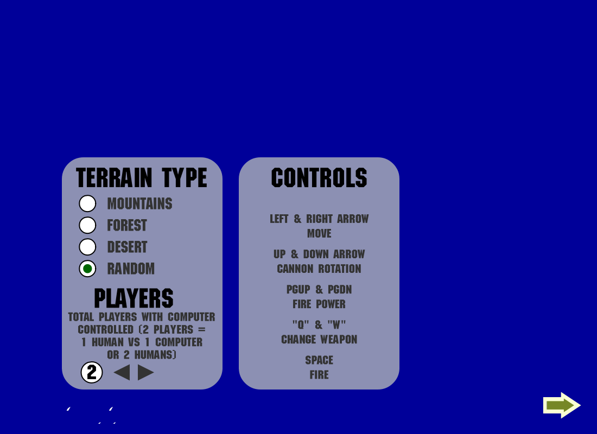
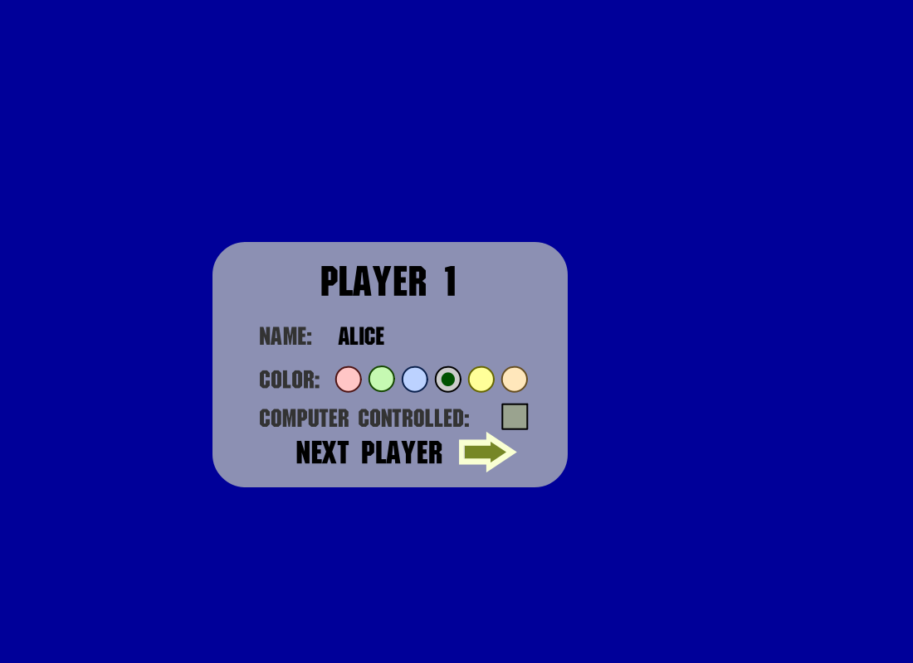
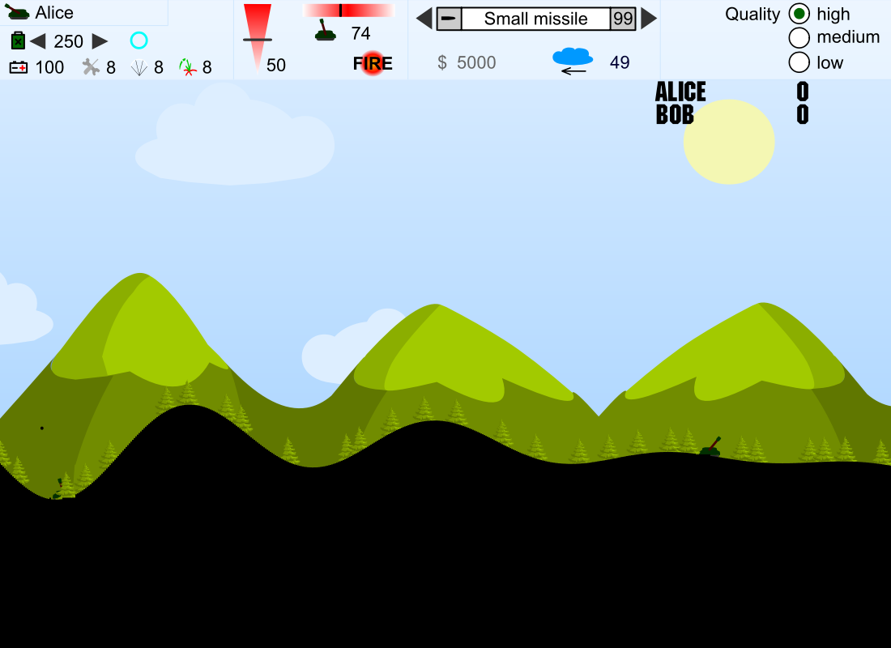
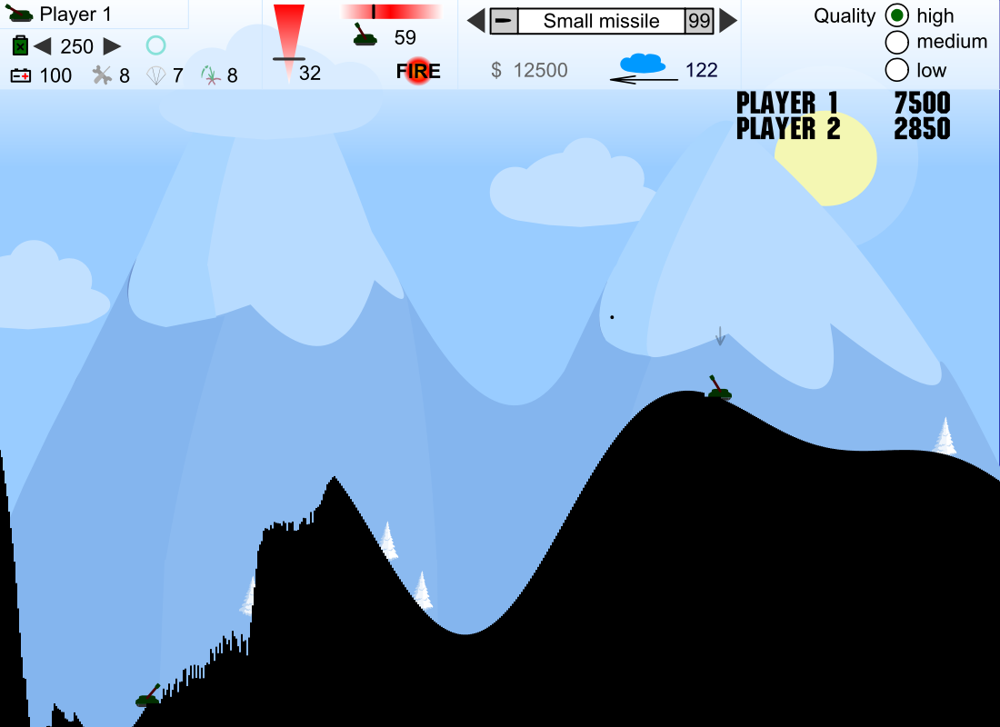

# Tanks — static recompilation of `tanks.swf` to C++20 + SDL3

`tanks.swf` is a Flash 5 (SWF5, ActionScript 1 / AVM1) game. This project translates **all of its bytecode
into C++ ahead of time** (no interpreter) and links it against a native Flash-player runtime built on SDL3.

| Game setup | Player setup |
| --- | --- |
|  |  |
| **Start of a match** | **Several rounds in (two computer players)** |
|  |  |

*Screenshots are 1100×800 frames from the recompiled build (`--test … --scale 2 --shot`).*

```
tanks.swf ──tools/recomp/gen.py──▶ build/gen/*.cpp   (one C++ function per frame script, button action,
                                                      onClipEvent block and DefineFunction)
                                        │
rt/ (AVM1 semantics, display list,      ▼
     PlutoVG rasterizer, audio, SDL3) ──link──▶ tanks.exe  ──reads assets at runtime──▶ tanks.swf
```

* 288 action blocks → 158 frame scripts, 58 button actions, 72 clip events, 136 functions; every opcode the
  game uses is translated (stack values are cached in C++ locals, jumps become `goto`s).
* Shapes, morph shapes, JPEG bitmaps, fonts, text and MP3 sounds are read from the SWF when the program starts,
  so the SWF has to sit next to the executable (the build copies it there) or be passed as the first argument.

## Building (Windows)

The quickest way is to double-click `build.bat`, or run it from a command prompt:

```bat
build.bat           :: install missing dependencies, build, test, package
build.bat clean     :: same, from a fresh build directory
build.bat update    :: also run a full MSYS2 update first
```

It installs MSYS2 with `winget` if it is missing (set `MSYS2_ROOT` if yours is not in `C:\msys64`). It then
installs the MinGW64 packages `gcc`, `cmake`, `ninja`, `sdl3`, `zlib` and `python` with `pacman`, builds a
Release `tanks.exe`, runs a 300-frame headless test, and writes the release to `dist\Tanks\` and
`dist\Tanks-windows-x64.zip`.

### Building by hand (MSYS2 MinGW64)

Requires `mingw-w64-x86_64-{gcc,cmake,ninja,sdl3,zlib}` and Python 3.

```bash
export PATH=/c/msys64/mingw64/bin:$PATH
cmake -G Ninja -B build-mingw
ninja -C build-mingw
build-mingw/tanks.exe
```

On Windows the result is one self-contained `tanks.exe` (SDL3, the C++ runtime, winpthread and zlib are
linked statically), so it starts from Explorer without MSYS2 on PATH. It only needs `tanks.swf` beside it, and the
build copies that there. Configure with `-DTANKS_STATIC=OFF` to use the shared `SDL3.dll` instead.

The generator runs as a build step whenever `tanks.swf` or `tools/recomp/*.py` change. Other platforms work the
same way with a system SDL3 (device fonts are looked up in the usual Linux/macOS font folders).

Controls are the game's own (arrows, PgUp/PgDn, Q/W, Space). F11 toggles fullscreen.

### Window size

The stage is 550×400 (11:8). Vector graphics and text are rasterized at the window's own resolution, so any
size is sharp; the 11:8 shape is kept while resizing so there are no black bars. By default the window opens
at the largest half-step multiple of the stage that fits 90% of the screen's usable area. Override it with
`--size WxH`.

| Display | Recommended window | Scale |
| --- | --- | --- |
| 1366×768 laptop | 825×600 | 1.5× |
| 1920×1080 | **1100×800** | 2× |
| 2560×1440 | **1650×1200** | 3× |
| 3840×2160 | 2475×1800 | 4.5× |

With Windows display scaling above 100%, the usable area is smaller, so the default picks a smaller multiple.
F11 fullscreen letterboxes the stage to the full screen height.

## Headless test mode

```bash
tanks.exe --test FRAMES [--shot out.bmp] [--scale S] [--shots-every N]
          [--click F:X:Y] [--key F:CODE[:HOLD]] [--type F:TEXT] [--dump F:PATH]
```

Runs FRAMES logic ticks without a window, injecting clicks, key presses (Flash key codes, held HOLD ticks),
typed text and object dumps (`--dump 700:_root` prints a clip's frame, named children and variables).
Example — two computer players for 9000 ticks:

```bash
tanks.exe --test 9000 --click 80:517:373 --click 275:310:251 --click 290:293:272 --click 340:293:272 --shot soak.bmp
```

## Layout

| Path | Contents |
| --- | --- |
| `tools/recomp/` | `gen.py` AVM1 → C++ translator, SWF/AVM1 decoders (forked from IsaacRecomp) |
| `tools/inspect/` | SWF inspection scripts: tag inventory, disassembler, API-usage scan |
| `rt/` | runtime: `core` (values, GC, scopes), `builtins`, `display` (timeline, events), `swfload`, `raster` (PlutoVG), `audio` (SDL3), `main_sdl3.cpp` |
| `third_party/` | PlutoVG, stb_image (JPEG), dr_mp3 |

## Changes made to the forked runtime for this game

* **SWF5 clip events** (`onClipEvent` load/enterFrame/unload/mouse/key) — generator, loader and dispatch.
* **CloneSprite / `duplicateMovieClip`** (copies transform, colour and clip events), **StartDrag/EndDrag**, **GetURL2**.
* **Flash 5 coercions**: `undefined` → `0` / `""`, strings tested for truth through number conversion.
* **SDL3** audio stream and front-end; whole-stage software rendering through the existing PlutoVG painter.
* **Device-font text fields** drawn with a system TrueType face (the SWF only embeds a 24-glyph Arial subset).
* **HTML text fields** (initial `<P>`/`<FONT COLOR>` markup) and **input text fields** (click to focus, type).

## Known deviations

* Identifiers stay case-sensitive (Flash 5 is case-insensitive); the game never relies on it — every
  identifier and built-in is spelled consistently, which was checked against all 488 names it uses.
* `getURL` to web pages (the sponsor links) is ignored instead of opening a browser.
* `_quality` has no visual effect (always anti-aliased).

See `THIRD-PARTY-LICENSES.txt` and `LICENSE-IsaacRecomp.txt` for licensing.
